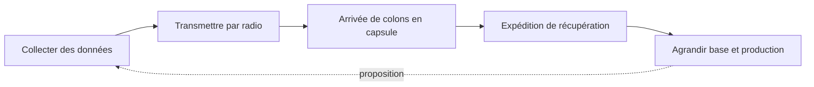

# Boucle de jeu principale

1. Le joueur **collecte des informations scientifiques** sur la planète ([[Collecte de données scientifiques]]).
2. Il les **transmet par radio** à une équipe de scientifiques ([[Les scientifiques]]).
3. En échange des données récoltées, les scientifiques **envoient de nouveaux colons**, qui aident au développement de la colonie ([[Colons et spécialités]]).
4. Les colons arrivent dans des **capsules identiques à celle du joueur**, qui atterrissent **plus ou moins loin de la base**. Il faut mener des **expéditions** pour aller les récupérer ([[Expéditions de récupération]]).
5. Il faut **agrandir la production et la base** pour les accueillir dans de bonnes conditions, **sinon ils risquent de mourir** ([[Ressources vitales]] · [[Base de dômes]]).

- *(proposition)* La flèche en pointillé : les colons accueillis aident au développement, ce qui permet d'explorer et de collecter davantage. Le concept dit qu'ils « aident au développement de la colonie », sans préciser s'ils relancent la collecte.
- **Filet de sécurité :** en cas de mauvaise gestion, les scientifiques envoient des rations ([[Production de nourriture]]).

## Dans le jeu aujourd'hui
- La transmission radio n'existe pas encore : le relais radio est un objet posé sans effet ([[F47 - Relais radio|F47]]).

Voir aussi : [[Fiche du jeu]] · [[Progression de la partie]]
